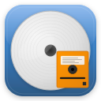

<div align="center">
  
  <h1>📦 AutoRip2MKV Installation Guide</h1>
  <p><em>Step-by-step installation instructions for macOS</em></p>
</div>

## 🚀 Install

1. **Download the latest DMG** from [GitHub Releases](https://github.com/gmoyle/AutoRip2MKV-Mac/releases/latest).
2. **Open the DMG** and drag AutoRip2MKV to Applications.
3. **Launch AutoRip2MKV.** Releases are signed with a Developer ID and notarized by
   Apple, so the app opens normally; no right-click or security override is needed.
4. **Allow disc access.** The first time a disc is inserted, macOS asks whether
   AutoRip2MKV may access files on a removable volume. Click **Allow**; the app can't
   read discs without it.

That's all you need for DVDs.

## 🎬 FFmpeg

AutoRip2MKV uses FFmpeg to encode. On launch it looks for one in this order:

1. An `ffmpeg` inside the app bundle
2. `~/Library/Application Support/AutoRip2MKV-Mac/ffmpeg` (one the app downloaded earlier)
3. Homebrew (`/opt/homebrew/bin/ffmpeg`, `/usr/local/bin/ffmpeg`)
4. Anything else on your `PATH`

If none is found, the app downloads a static build from evermeet.cx into Application
Support. That build is Intel-only: it runs under Rosetta and can't use hardware
encoding. **For hardware-accelerated encoding on Apple Silicon, install Homebrew's
native build**, which the app prefers when both exist:

```bash
brew install ffmpeg
```

## 💿 Blu-ray: MakeMKV

Blu-ray discs are ripped with [MakeMKV](https://www.makemkv.com/), installed at
`/Applications/MakeMKV.app`. On first launch the app offers to help you install it,
or you can download it from [makemkv.com/download](https://www.makemkv.com/download/).

MakeMKV's free beta builds stop working after a while ("This application version is
too old"). When that happens, AutoRip2MKV shows a dialog where **Download & Install**
fetches the current MakeMKV from makemkv.com and replaces the old copy. You can also
enter a registration key there.

MakeMKV's Homebrew cask is deprecated (it fails Gatekeeper), so don't install it that way.

## 🛡️ Security and privacy

- **Open source**: all code is in this repository.
- **Network use**: the app connects to the internet only to look up movie titles
  (OMDb), to download FFmpeg if you don't have it, and to download MakeMKV when you
  click **Download & Install**. Ripping and encoding happen locally.
- **Sleep**: while a rip is running the app keeps the Mac from idle-sleeping, because
  sleep cuts power to USB drives mid-read. Normal sleep resumes when the job finishes.

## 🔨 Build from source

```bash
brew install libdvdcss libaacs
git clone https://github.com/gmoyle/AutoRip2MKV-Mac.git
cd AutoRip2MKV-Mac
swift build && swift run
```

`./deploy.sh` builds a release copy into `~/Applications/AutoRip2MKV-Mac.app`, signs
it, and launches it.

## 🔧 Troubleshooting

### Discs aren't detected

Check System Settings → Privacy & Security → Files and Folders → AutoRip2MKV and make
sure **Removable Volumes** is on. Also quit DVD Player if it opened on its own: it
holds the drive.

### Encoding fails immediately

Check which FFmpeg the app found (it's written to the log panel on launch). If it's
the downloaded Intel build and Rosetta isn't installed, install Homebrew's build
(`brew install ffmpeg`) or run `softwareupdate --install-rosetta`.

### Blu-ray rips fail with a licensing message

Use **Download & Install** in the MakeMKV dialog, or open MakeMKV and enter a key.

### A Blu-ray can't be opened ("Failed to open disc")

Make sure nothing else is using the drive (MakeMKV's own window, DVD Player, another
ripper), then reinsert the disc.

## 📋 System Requirements

- **macOS 13.0** or later, Apple Silicon
- **Optical drive** (USB drives work)
- **MakeMKV** for Blu-ray
- **Internet** only for title lookup and the one-time FFmpeg / MakeMKV downloads

## 🆘 Need Help?

Check the [Issues](https://github.com/gmoyle/AutoRip2MKV-Mac/issues) for similar
problems, or open a new one with your macOS version, the disc, and the log panel's
output.

---

*This app is an AI development experiment; see [WARP_AI_EXPERIMENT.md](WARP_AI_EXPERIMENT.md) for the story.*
