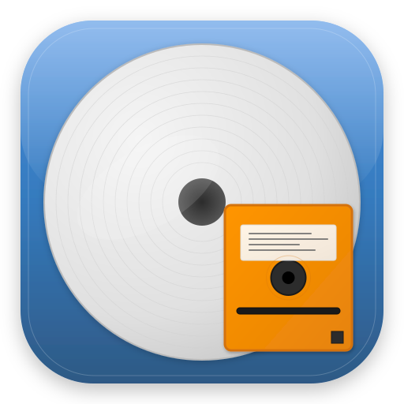

<div align="center">
  
  <h1>AutoRip2MKV for Mac</h1>
  <p><em>DVD & Blu-ray Ripping with Open-Source Decryption</em></p>
  <p><sub>v2.1.0 - Faster, correct DVD rips (including multi-version discs) and in-app MakeMKV updates</sub></p>
  
  [](https://github.com/gmoyle/AutoRip2MKV-Mac/releases/latest)
  [-blue)](https://github.com/gmoyle/AutoRip2MKV-Mac/releases/latest)
</div>

> 🤖 **AI Development Experiment**: This entire application was built using AI assistance (Warp 2.0 + Claude Code) by someone with zero Swift experience and an Art Degree. [Read the full experiment documentation](./WARP_AI_EXPERIMENT.md) 🎨→👨‍💻

A native macOS application for automatically ripping DVDs and Blu-rays to MKV format. **DVDs rip with no setup** using open-source libdvdcss; **Blu-ray** decryption is handled by [MakeMKV](https://www.makemkv.com/) (see [Blu-ray support](#blu-ray-support-requires-makemkv)).

## Features

- **Hands-free ripping** - Insert a disc and walk away: auto-rip on insert, auto-eject when the read finishes, skip discs already ripped
- **DVD CSS Decryption** - Open-source libdvdcss for Content Scramble System decryption
- **Fast DVD reads** - Titles are read at full drive speed to local storage, the disc ejects, and encoding runs in the background while the next disc reads
- **Multi-version discs** - Follows DVD seamless branching, so discs with several cuts of the movie rip as one clean title
- **Damaged discs** - Unreadable sectors are retried, then skipped (up to a limit) instead of failing the rip
- **Blu-ray Support** - Via MakeMKV (auto-detected once installed); the app helps you install it, and can update an expired build for you
- **DVDs need nothing extra** - No MakeMKV, key database, or other tools required for DVD ripping
- **All tracks captured** - Every audio and subtitle track, tagged with languages from the disc
- **Auto-deinterlace** - Interlaced (NTSC) sources are deinterlaced automatically
- **Plex-ready** - `Movie (Year)` naming, with finished rips sorted into separate Movies and TV Shows library folders
- **Main movie or everything** - Rip only the main feature (default), or bonus features too
- **FFmpeg set up for you** - Downloaded on first launch if it isn't already installed
- **Hardware Acceleration** - Optional VideoToolbox H.264/HEVC encoding
- **Stays awake** - The Mac won't idle-sleep in the middle of a rip
- **Automatic Drive Detection** - Smart optical drive detection and selection
- Native macOS interface built with Swift and AppKit; persistent settings
- Progress tracking and logging with real-time updates
- Automatic DVD/Blu-ray structure analysis and title detection
- Chapter preservation and metadata inclusion
- Multiple video/audio codec support (H.264, H.265, AV1, AAC, AC3, DTS, FLAC)
- Configurable quality settings
- **🤖 100% AI-Generated**: ~24,000 lines of Swift (app and tests) created entirely by AI

## Installation

### 📦 **Recommended: Download Release** (Easiest)

**✨ Just download and run - no building required!**

1. **Download the latest release** from [GitHub Releases](https://github.com/gmoyle/AutoRip2MKV-Mac/releases)
2. **Open the DMG file** and drag AutoRip2MKV to Applications
3. **Launch it.** The app is signed and notarized by Apple, so it opens normally.
4. **FFmpeg**: on first launch the app downloads FFmpeg if it isn't already installed.
   For hardware-accelerated encoding on Apple Silicon, install a native build with
   `brew install ffmpeg`; the app finds it automatically.
5. **Start ripping!** DVDs need nothing else. For Blu-ray, see [Blu-ray support](#blu-ray-support-requires-makemkv).

> 📋 **Need help with installation?** See the detailed [Installation Guide](INSTALLATION.md) for step-by-step instructions to handle macOS security restrictions.

### 🛠️ **Alternative: Build from Source** (For Developers)

**⚠️ Only needed if you want to modify the code or contribute**

**Requirements:**
- macOS 13.0 or later
- Swift 5.8+ and Xcode Command Line Tools
- Homebrew `libdvdcss` and `libaacs`: `brew install libdvdcss libaacs`

**Steps:**
```bash
git clone https://github.com/gmoyle/AutoRip2MKV-Mac.git
cd AutoRip2MKV-Mac
swift build && swift run
```

`./deploy.sh` builds a release copy into `~/Applications` and launches it.

## Usage

### First-Run Setup

When you launch AutoRip2MKV for the first time, the application will:

1. **Find FFmpeg** - Use an installed FFmpeg (Homebrew's is preferred), or download one
2. **Hardware Detection** - Test if your Mac supports VideoToolbox hardware acceleration
3. **Acceleration Dialog** - If supported, offer to enable hardware acceleration for faster processing
4. **Save Preferences** - Your choice is remembered for future sessions

### Normal Operation

With the default settings, ripping is hands-free — insert a disc and walk away:

1. **Launch AutoRip2MKV** from Applications (leave it running).
2. **Insert a DVD/Blu-ray.** The app detects it, identifies the movie, and starts ripping automatically.
3. **The disc ejects** when the read finishes; encoding continues in the background.
4. **Insert the next disc.** Repeat for as many as you like.

The main window shows the queue and live progress (disc-read size, then encode
percentage). The app handles everything automatically:
- ✅ FFmpeg found or downloaded automatically
- ✅ Drive detection, disc identification (OMDb), and CSS/AACS decryption
- ✅ Auto-deinterlace of interlaced (NTSC) sources
- ✅ All audio and subtitle tracks captured, with language labels
- ✅ Conversion to MKV, with Plex-style `Movie (Year)` naming
- ✅ Automatic Movies / TV Shows routing into separate Plex library folders
- ✅ Auto-eject when the read completes; already-ripped discs are skipped
  (a disc whose rip folder you deleted is ripped again)
- ✅ Optional hardware acceleration (VideoToolbox)
- ✅ Cancel a rip in progress from the main window

**Overrides**: a disc already ripped with the current settings is skipped and
ejected. Change any rip setting, hold **⌥ Option** while inserting, or click
**Start Ripping** to force a re-rip. Auto-rip, auto-eject, and skip-already-ripped
each have a checkbox in the main window; the output directory can be changed with
**Browse** (it defaults to your Plex movie library if one is found).

Rip settings live in **Settings…** (Output & Routing, Encoding, Advanced). See the
[Settings Guide](DETAILED_SETTINGS_GUIDE.md) for each option.

### Plex

Rips are named `Movie (Year)/Movie (Year).mkv`. With content routing on
(Settings → Output & Routing), each finished rip is classified as a movie or a TV
season and moved into your Movies or TV Shows folder; rips the app isn't sure about
wait under **Review Rips**. The library folders can be on a NAS: files are copied
under a hidden name and renamed when complete, so Plex never sees a partial file.
Ripping the same disc again replaces its files in place rather than creating a
second folder.

Encoding always happens in a local cache folder; only finished files are moved to
your output and library folders, so an iCloud- or network-synced folder never
holds a half-written file.

### Blu-ray support (requires MakeMKV)

**DVDs rip with no setup.** Blu-ray discs use AACS/BD+ copy protection that
AutoRip2MKV cannot legitimately decrypt on its own, so Blu-ray ripping is handled
by [MakeMKV](https://www.makemkv.com/) (free during its beta), which manages
decryption with its own keys. AutoRip2MKV ships no decryption keys.

- On **first launch**, the app offers to help you install MakeMKV. You can also
  install it any time from [makemkv.com/download](https://www.makemkv.com/download/).
- MakeMKV's free beta builds expire. When that happens the app tells you, and
  **Download & Install** fetches the current version from makemkv.com and replaces
  the old one (or you can enter a registration key).
- Once MakeMKV is installed, AutoRip2MKV **detects and uses it automatically** —
  insert a Blu-ray and it rips just like a DVD, with the same Plex-style naming
  and output location.
- The **"Use MakeMKV for Blu-ray"** setting (Detailed Settings, on by default)
  controls this. Advanced users can instead supply a libaacs key database at
  `~/.config/aacs/KEYDB.cfg` to use the built-in libaacs path.
- DVDs use the built-in reader by default. **Also use MakeMKV for DVDs** switches
  them to MakeMKV too; it's slower, because MakeMKV scans the whole disc first.

> **Note:** MakeMKV's Homebrew cask is deprecated (it fails macOS Gatekeeper).
> Install from makemkv.com, or let the app do it.

### DVD Structure

The application expects a mounted DVD with the standard VIDEO_TS structure:
```
/Volumes/YOUR_DVD/
└── VIDEO_TS/
    ├── VIDEO_TS.IFO
    ├── VTS_01_0.IFO
    ├── VTS_01_1.VOB
    ├── VTS_01_2.VOB
    └── ...
```

## Development

This project is built using Swift Package Manager and native macOS frameworks:

- **Swift**: Primary programming language
- **AppKit**: Native macOS UI framework
- **Cocoa**: macOS development framework

### Project Structure

Key files in `Sources/AutoRip2MKV-Mac/` (see [CLAUDE.md](CLAUDE.md) for the full architecture):

| File | Role |
|------|------|
| `DriveDetector.swift` | Watches for disc mounts and unmounts |
| `MainViewController*.swift` | Main window, skip-already-ripped check, MakeMKV dialogs |
| `ConversionQueue.swift` | Job queue: disc read, then background encode |
| `MediaRipper*.swift` | Per-format rippers (DVD, Blu-ray, HD DVD) and FFmpeg encoding |
| `DVDStructureParser.swift`, `DVDDecryptor.swift` | DVD IFO parsing and libdvdcss reads |
| `MakeMKVBackend.swift`, `MakeMKVInstaller.swift` | Blu-ray via `makemkvcon`, MakeMKV install/update |
| `ContentRouter.swift`, `ContentTypeClassifier.swift` | Movies / TV Shows routing |
| `RipHistoryStore.swift`, `DiscIdentity.swift` | Which discs have been ripped |

Tests are in `Tests/AutoRip2MKV-MacTests/`.

### Building

**Note:** Most users should download the pre-built release instead of building from source.

```bash
swift build && swift test   # build and run the tests
./deploy.sh                 # release build to ~/Applications, signed, launched
```

## 📚 Documentation

- **[Installation Guide](INSTALLATION.md)** - Detailed setup instructions for macOS
- **[User Guide](WIKI_USER_GUIDE.md)** - How to use the app
- **[Settings Guide](DETAILED_SETTINGS_GUIDE.md)** - Every setting explained
- **[Decryption Libraries](DECRYPTION_LIBRARIES.md)** - Integration details for libdvdcss and libaacs
- **[Changelog](CHANGELOG.md)** - Release history and version changes
- **[Roadmap](ROADMAP.md)** - Project timeline and planned features

## 🗺️ Roadmap

See our comprehensive [**Roadmap**](ROADMAP.md) for planned features, enhancements, and long-term project goals including:

- **Enhanced 4K Support**: Ultra HD Blu-ray detection and processing
- **Hands-free automation**: auto-rip on insert, auto-eject, skip already-ripped discs
- **Professional Features**: Metadata management and enterprise tools
- **Cross-Platform Expansion**: Linux and Windows support evaluation
- **AI Development Evolution**: Next-generation code generation experiments

## Contributing

1. Fork the repository
2. Create a feature branch (`git checkout -b feature/amazing-feature`)
3. Commit your changes (`git commit -m 'Add some amazing feature'`)
4. Push to the branch (`git push origin feature/amazing-feature`)
5. Open a Pull Request

## License

This project is licensed under the MIT License - see the LICENSE file for details.

## Technical Details

### CSS/AACS Decryption

This application uses open-source decryption libraries (libdvdcss and libaacs) from VideoLAN for production-ready DVD and Blu-ray decryption:

**DVD Decryption (libdvdcss)**:
- CSS authentication and key management
- Automatic title key retrieval
- Sector-by-sector decryption during read operations
- Battle-tested implementation from VLC Media Player

**Blu-ray Decryption (libaacs)**:
- AACS authentication and processing
- 6144-byte unit decryption
- KEYDB.cfg integration for key management
- Production-ready Blu-ray support

### DVD Structure Analysis

The application parses the DVD structure natively:

- VMGI (Video Manager Information) parsing
- VTS (Video Title Set) analysis
- Program Chain (PGC) information extraction
- Chapter and cell information parsing
- Duration and metadata extraction
- Seamless branching: interleaved cells are followed VOBU by VOBU through each
  nav pack's next-VOBU pointer, the way a DVD player does

### Video Conversion

After decryption, the application uses bundled FFmpeg for video conversion:

- FFmpeg is found on the system (Homebrew preferred) or downloaded on first launch
- Support for multiple codecs (H.264, H.265, VP9, AV1), with VideoToolbox for H.264/HEVC
- Audio codec options (AAC, AC3, DTS, FLAC)
- Chapter preservation
- Metadata inclusion
- Quality settings (CRF-based)

## Legal Notice

This software is intended for legitimate backup purposes of DVDs you legally own. Users are responsible for complying with all applicable laws regarding DVD copying and CSS circumvention in their jurisdiction.

## 🚀 Warp 2.0 AI Experiment

This project represents a groundbreaking experiment in AI-powered software development:

- **Developer**: Art degree, zero Swift experience
- **Code written by human**: 0 lines — 100% AI-generated
- **Development method**: 100% AI-assisted (Warp 2.0, then Claude Code)
- **Codebase**: ~24,000 lines of Swift across the app and tests
- **Latest release**: v2.1.0 - Faster, correct DVD rips and in-app MakeMKV updates (Nov 2026)
- **Features**: DVD/Blu-ray ripping, libdvdcss/libaacs decryption, hands-free auto-rip, all-track capture, Plex-ready output

**[📖 Read the full experiment documentation](./WARP_AI_EXPERIMENT.md)** to see how AI democratizes software development.

*"From art degree to Swift developer in one conversation"* 🎨→👨‍💻

## Acknowledgments

- **Warp 2.0 Agent Mode** for making this experiment possible
- **Susanne Moyle** for recommending the nostalgic floppy disk design element
- The Swift and macOS development communities
- FFmpeg project for video conversion capabilities
- DVD Forum specifications for DVD structure documentation

## 🎨 App Icon

<div align="center">
  <table>
    <tr>
      <td align="center">
        
        <br><strong>Main Icon</strong>
        <br><em>512×512 Application Icon</em>
      </td>
      <td align="center">
        
        <br><strong>Simple Icon</strong>
        <br><em>128×128 Favicon & Small UI</em>
      </td>
      <td align="center">
        
        <br><strong>Horizontal Logo</strong>
        <br><em>400×120 Documentation & Web</em>
      </td>
    </tr>
  </table>
  
  <p><em>Professional macOS-style icon featuring a large DVD disc with bright orange floppy disk overlay,<br>representing the classic-to-digital conversion process. Floppy disk design recommended by<br><strong>Susanne Moyle</strong> for nostalgic throwback appeal, with anatomically correct vertical access window.</em></p>
</div>
